  

  
  
  
  

## Sobre mim

Software Engineer .NET com foco em **IA aplicada**. Sou responsável técnico pelos sistemas de uma
administradora de consórcios de ponta a ponta: arquitetura, desenvolvimento, infraestrutura em nuvem
e segurança. Estruturei um fluxo de engenharia com **agentes de IA (Claude Code e Codex)**, com regras,
revisão humana e testes automatizados, que sustenta **mais de 10 sistemas em produção**.

- 🧠 **IA aplicada:** agentes de IA no desenvolvimento, LLMs com function calling e RAG
- ⚙️ **Backend:** C#, .NET 8/9, ASP.NET Core, EF Core, Dapper, APIs REST
- 🔁 **Eventos e automação:** RabbitMQ, MassTransit, workers, RPA e n8n
- ☁️ **Nuvem e DevOps:** AWS, Linux, Docker, nginx, Cloudflare, CI/CD
- 🛡️ **Segurança:** 2FA, auditoria, CSP, LGPD, varredura contínua de vulnerabilidades

## Como eu entrego com IA

  

| Princípio | Na prática |
|---|---|
| **Governança em todo repositório** | `AGENTS.md` / `CLAUDE.md` com arquitetura, regras de segurança, proteção contra prompt injection e o que exige aprovação humana |
| **Verificação proporcional** | o agente só declara pronto o que foi testado: comportamento alterado, autorização, isolamento e regressão |
| **Custo sob controle** | contexto enxuto e leitura seletiva; medi e reduzi o custo de tokens por entrega |
| **Segurança antes de velocidade** | segredos fora do contexto, homologação antes de produção, ações externas com confirmação |

## Cases

Sistemas corporativos apresentados sem telas, nomes de clientes ou endereços. Cada case tem página com arquitetura, decisões e resultado.

| Case | O que resolve | Destaque |
|---|---|---|
| [**Plataforma comercial e API central**](https://adrianmoraisdev.github.io/adrian-higa-portfolio/cases/plataforma-comercial/) | Simulação de planos, comissões, campanhas e assinatura digital em uma API única | ~300 endpoints · 307 testes · deploy sem queda |
| [**Automação orientada a eventos**](https://adrianmoraisdev.github.io/adrian-higa-portfolio/cases/automacao-orientada-a-eventos/) | Cadastros no ERP legado e sincronização de vendas sem trabalho manual | RabbitMQ · DLQ · idempotência |
| [**Apuração de assembleias ao vivo**](https://adrianmoraisdev.github.io/adrian-higa-portfolio/cases/assembleias-ao-vivo/) | Sorteio e lances calculados em tempo real, exportados no formato do ERP | .NET 9 · regras no domínio · 73 testes |
| [**Painéis executivos e de vendas**](https://adrianmoraisdev.github.io/adrian-higa-portfolio/cases/paineis-executivos/) | Resultado e metas para diretoria, gerentes e equipes, do celular ao telão | 2FA · CSP · containers somente leitura |
| [**Infraestrutura em nuvem e DevSecOps**](https://adrianmoraisdev.github.io/adrian-higa-portfolio/cases/infraestrutura-devsecops/) | Ambiente de produção configurado do zero e operado sem time dedicado | AWS · Cloudflare · Trivy + CISA KEV |
| [**Agente de atendimento com LLM**](https://adrianmoraisdev.github.io/adrian-higa-portfolio/cases/agente-atendimento-llm/) | Assistente que consulta catálogo, pedidos e políticas sem inventar números | function calling · RAG · 3 provedores |
| [**Acervo e integração de assinatura digital**](https://adrianmoraisdev.github.io/adrian-higa-portfolio/cases/assinatura-digital/) | Cópia fiel dos contratos desde 2021 e migração de plataforma com segurança | somente leitura garantida por teste |
| [**EngPav: diário de obra com 3D**](https://adrianmoraisdev.github.io/adrian-higa-portfolio/cases/engpav/) | Relatório diário de pavimentação offline, com a rua em 3D | Electron · React 19 · three.js |

## Repositórios públicos

- 🤖 [**emporio-musica-agent**](https://github.com/adrianmoraisdev/emporio-musica-agent): agente de atendimento com LLM, function calling multi-provedor e RAG BM25 (Python, 40 testes)
- 🌐 [**adrian-higa-portfolio**](https://github.com/adrianmoraisdev/adrian-higa-portfolio): este portfólio, em Next.js com exportação estática e deploy no GitHub Pages
- 🏗️ [**EngPav-releases**](https://github.com/adrianmoraisdev/EngPav-releases): instaladores do EngPav com atualização automática

## Stack

  
   
  

  
  
  
  
  
  

## Trajetória

| Período | Cargo | Empresa |
|---|---|---|
| mai. 2024 — atual | Analista de TI Pleno · Software Engineer .NET & IA | Consórcio Guerra Brasil |
| jun. 2023 — abr. 2024 | Desenvolvedor Backend .NET | Ololu Plataforma Digital |
| jul. 2021 — mai. 2023 | Estagiário de Tecnologia · .NET Core e C# | Ololu Plataforma Digital |

---

  <b>Procurando alguém que entregue .NET e IA em produção?</b> 
  <a href="https://www.linkedin.com/in/adrianhiga-tech">LinkedIn</a> ·
  <a href="mailto:adrianmorais.dev@gmail.com">adrianmorais.dev@gmail.com</a> ·
  <a href="https://adrianmoraisdev.github.io/adrian-higa-portfolio/">Portfólio</a>

